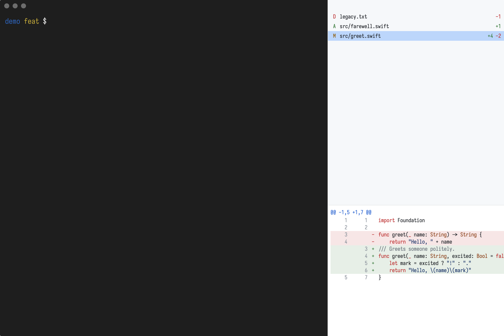

<p align="center"></p>

<h1 align="center">diffary</h1>

<p align="center">a terminal that knows what your branch changed</p>

A Ghostty terminal with a live sidebar of what your branch changed vs its base.


| side-by-side | light theme | sidebar at bottom |
|---|---|---|
|  |  |  |

Regenerate: `scripts/screenshot.sh docs/screenshots/<name>.png [diffary flags]`

## Install

```sh
scripts/bundle.sh --install                       # → ~/Applications/Diffary.app
ln -sf "$PWD/scripts/diffary" ~/.local/bin/diffary
```

Needs the Command Line Tools (no Xcode) and `gh` access to this repo's releases (GhosttyKit is built in CI, on the `macos-15` GitHub Actions runner).

On a Command Line Tools-only machine plain `swift test` fails; run `scripts/test.sh` instead.

## Use

```sh
diffary [repo] [--config FILE] [--base BRANCH] [--set key=value]...
```

## Config

`$XDG_CONFIG_HOME/diffary/config.toml` (default `~/.config/diffary/config.toml`). `scripts/bundle.sh --install` creates it from `config.example.toml` if missing (never overwrites). Reloaded on save.

```toml
base_branch = "master"        # falls back to "main"

[layout]
sidebar = "right"             # right | left | bottom
sidebar_size = 0.35           # 0.1–0.9, fraction of window
diff_position = "below_list"  # below_list | beside_list | replace_terminal

[diff]
view = "unified"              # unified | side_by_side
context_lines = 3             # lines before/after each change, 0–1000
ignore_whitespace = false
syntax_highlight = true

[appearance]
font = "terminal"             # terminal = Ghostty's font; else a font name; system monospace if missing
font_size = 13
theme = "ghostty"             # ghostty (match the terminal) | auto | light | dark | <user theme name>
titlebar = false              # true shows the window title bar
```

See `docs/superpowers/specs/2026-11-04-diffary-design.md` for every key and the theme format.
Themes: `~/.config/diffary/themes/<name>.toml`, selected with `[appearance] theme = "<name>"`.
Terminal settings come from Ghostty's own config.

## Icon

`assets/icon.svg` is the app icon (`icon-small.svg` for 16–32px). After editing either, run `scripts/make-icon.sh` to rebuild the committed `assets/AppIcon.icns`.

## Bumping Ghostty

Put a new sha in `GHOSTTY_COMMIT` and push. CI publishes a new GhosttyKit; `scripts/fetch-ghosttykit.sh` picks it up.
The embedding API isn't stable, so expect to fix `TerminalView`/`GhosttyRuntime` after a bump.
